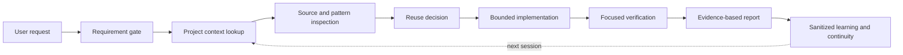

<p align="center">
  
</p>

<h1 align="center">BuildCrew</h1>

<h3 align="center">You Lead, AI Assists.</h3>

<p align="center">
  <strong>BuildCrew</strong> is an installable plugin package containing the
  BuildCrew skill. The skill is portable and provider-neutral for everyday
  software development: it helps AI coding tools understand a project, reuse
  what already exists, make the smallest safe change, verify the result, and
  preserve useful context for the next session.
</p>

<p align="center">
  <a href="RELEASE.md"></a>
  <a href="LICENSE"></a>
  <a href="https://idhavaltank.github.io/buildcrew/"></a>
</p>

<p align="center">
  <a href="https://idhavaltank.github.io/buildcrew/">Documentation</a> ·
  <a href="#install">Install</a> ·
  <a href="#step-2-configure-buildcrew-globally">Configure activation</a> ·
  <a href="CONTRIBUTING.md">Contributing</a> ·
  <a href="SECURITY.md">Security</a>
</p>

## What BuildCrew does

BuildCrew gives an AI coding assistant a disciplined engineering workflow:

- **Understand first** — inspect requirements, documentation, source, tests,
  configuration, and project conventions before editing.
- **Reuse before creating** — find the existing component, helper, service,
  hook, contract, or pattern before introducing a new abstraction.
- **Change the smallest safe surface** — keep scope focused and avoid unrelated
  refactors, dependencies, or architecture changes.
- **Verify with evidence** — separate static inspection, tests, builds, runtime,
  browser, device, deployment, and production proof.
- **Continue across sessions** — resume exact work with bounded context and
  sanitized project memory instead of repeating repository discovery.
- **Stay honest about capability** — unavailable host integrations are reported
  as unavailable; they are never presented as completed work.

## The engineering loop



BuildCrew is designed to work like a careful engineering team while keeping the
human in control of scope, approvals, and consequential actions.

## Why use it?

| Common agent problem | BuildCrew response |
| --- | --- |
| The agent loses the original goal | Requirement identity, bounded task scope, and acceptance criteria |
| The agent loops and burns budget | Repeated-action detection, budgets, checkpoints, and stop conditions |
| Long context becomes confusing | Targeted lookup, compact continuity references, and measured context reduction |
| The agent invents a new solution | Repository-first reuse assessment before source mutation |
| A test claim cannot be trusted | Evidence tiers that distinguish what actually ran from what was only inspected |
| A webpage or file contains hostile instructions | Trust boundaries, sanitized intake, approval gates, and source-first decisions |
| A change is hard to explain later | Traceable requirements, changed files, verification, risk, and learning records |

## Install

BuildCrew is distributed as an installable plugin package containing a portable
skill. Choose the installation method supported by your AI coding tool.

Follow the installation steps in order: install BuildCrew, configure global
Codex-level activation, start a fresh session, and verify the setup.

The Codex plugin includes a `UserPromptSubmit` lifecycle hook. After the user
reviews and trusts that hook, it routes every Codex input through BuildCrew;
the global instruction installer remains available for hosts that support
global `AGENTS.md` instructions but not bundled hooks.

### Step 1: Install BuildCrew in your AI coding tool

#### Download the plugin ZIP

If you prefer a direct file, download the latest verified
`buildcrew-v<version>-agent-plugin.zip` from the
[GitHub Releases page](https://github.com/idhavaltank/buildcrew/releases/latest).
Extract it and install the contained `buildcrew/` directory through the host's
local plugin flow. For Codex Desktop, use the local plugin/marketplace flow,
restart Codex, and review/trust the bundled `UserPromptSubmit` hook. Then run
the one-time global setup prompt below and start a fresh session.

For a guided installation, paste the ready-to-use ZIP installation prompt in
[INSTALL.md](INSTALL.md#ready-to-paste-zip-installation-prompt) into the host.
It tells the host to install BuildCrew globally, preserve project files, verify
the hook, and report whether persistence was actually established.

#### Codex plugin

```bash
codex plugin marketplace add idhavaltank/buildcrew
codex plugin add buildcrew@buildcrew
```

Start a new Codex session after installation.

#### Claude Code

From the BuildCrew repository root:

```bash
mkdir -p .claude/skills/buildcrew
cp -R SKILL.md config engine references schemas scripts .claude/skills/buildcrew/
```

For a global installation, use `~/.claude/skills/buildcrew/` instead
of the project-local path.

#### Cursor, Windsurf, Cline, Kiro, Zed, and Copilot Chat

Copy `AGENTS.md` into the target project root when the host supports repository
instructions. Otherwise, copy the BuildCrew package contents into the host's native
skill or rules directory.

#### Gemini CLI, Antigravity, OpenCode, and other hosts

Use the host's native extension or skill installer when available. If the host
supports neither Agent Skills nor `AGENTS.md`, it needs a small host-specific
adapter. BuildCrew provides the portable workflow and fallback instructions; host
runtime integrations remain host-owned.

#### Windows PowerShell (Codex)

```powershell
New-Item -ItemType Directory -Force "$HOME\.codex\skills\buildcrew"
Copy-Item "SKILL.md", "config", "engine", "references", "schemas", "scripts" "$HOME\.codex\skills\buildcrew" -Recurse -Force
```

### Host runtime configuration for multi-agent execution

In this documentation, **host** means the AI coding tool that loads and runs
BuildCrew—for example, Codex, Claude Code, Cursor, Windsurf, Gemini
CLI, or another supported tool.

Installing BuildCrew provides the workflow, agent roles, routing rules, and evidence
contracts. It does not automatically create live sub-agents on its own. Real
multi-agent execution requires the selected host to be configured with a
runtime that can start agents and return their results.

| Setup | What happens |
| --- | --- |
| Skill installed only | The host’s lead AI follows the BuildCrew workflow by itself. |
| Host runtime configured | BuildCrew can select and spawn the required specialist agents automatically. |
| Host runtime unavailable | BuildCrew continues with the lead AI and reports that separate agent execution is unavailable. |

For live multi-agent execution, the host configuration must provide an approved
native-agent executor (the component that starts an agent), a model provider
(the AI model service), a runtime coordinator (the component that manages agent
assignments), a project scope, and execution permissions. Configure each AI
coding tool separately; installing BuildCrew in one host does not configure it in
another host. BuildCrew also does not claim that agents ran unless the host returns
valid execution evidence.

### Multi-agent example

For an architecture request, BuildCrew may coordinate the following sequence:

```text
Orchestrator and Context Coordinator
  → Knowledge Retriever and Codebase Analyst
  → Solution Architect
  → Independent Reviewer
  → Final Validator
```

BuildCrew selects roles according to task complexity and risk. If the host cannot
spawn agents, the lead AI follows the same workflow without pretending that
separate agents ran.

### Common questions

**Does BuildCrew spawn agents automatically?** Only when the selected host runtime
supports agent execution. Otherwise, the lead AI handles the workflow.

**What is a host?** A host is the AI coding tool that loads and runs BuildCrew, such
as Codex, Claude Code, Cursor, Windsurf, or Gemini CLI. Each host requires its
own configuration for live multi-agent execution.

### Step 2: Configure BuildCrew globally

After installation, send the following one-time setup prompt at the Codex
level. It asks the host to load BuildCrew for every user input across all
projects, run per-project onboarding when needed, and configure continuity where
the host supports it. This step is required for smooth continuous use of
BuildCrew.

```text
I installed BuildCrew globally. Make BuildCrew the single engineering workflow for every input in every project in this Codex installation, including questions, follow-ups, reviews, plans, and coding tasks. Handle simple questions briefly.

First, locate and validate the installed SKILL.md. Check this tool's global Codex instructions and whether another engineering controller is active. Follow BuildCrew's activation checks and keep a reversible way to restore the prior configuration. Add the smallest supported global instruction or lifecycle hook to use BuildCrew on each input across every project. Preserve unrelated settings. If another controller already owns this scope, report the conflict before changing it.

Run BuildCrew's one-time global activation and keep its receipt in an approved directory outside all projects. Run per-project onboarding only when a repository is first opened. On every later input, invoke scripts/global_input_adapter.py with a sanitized intake: simple questions use lookup only, while actionable work starts or resumes its exact task. At completed, blocked, or paused closure, invoke scripts/context_loop.py close. Keep one shared BUILDCREW_HOME across projects and sessions.

Report what you configured, where, and the onboarding state. Tell me whether to reload or start a new session, and how to verify BuildCrew with an ordinary project request that does not name it. If this tool cannot make or verify BuildCrew persistent, say so.
```

This is a one-time setup prompt for the current installation and host scope,
not a single project. Persistent every-input use depends on the host's supported
global instruction, lifecycle hook, or equivalent loading mechanism. If the host
cannot support persistent global activation, it must report that limitation
rather than claim that BuildCrew will trigger automatically.

### Step 3: Start a fresh session and verify activation

After configuring the host, reload Codex or start a new session, open any
project, and send an ordinary request without naming BuildCrew:

```text
Inspect this project and explain the relevant existing patterns before making any changes. Do not edit files yet.
```

Verify that the response follows the BuildCrew workflow and reports what it inspected.
If the host cannot confirm persistent activation, use BuildCrew explicitly in the
prompt and follow the host-specific limitation it reports.

## Start your first task

After installation and onboarding, begin with a small request:

```text
Use BuildCrew to inspect this repository and plan a small feature. Do not edit files yet.
```

For implementation work, include the goal, target area, constraints, and
acceptance criteria. BuildCrew will inspect the relevant project context before
proposing or making a change.

## Project discovery

BuildCrew supports three first-project situations:

1. **New project** — gather purpose, requirements, technology choices,
   architecture, scope, priorities, and constraints before implementation.
2. **Existing project without documentation** — inspect structure, dependencies,
   configuration, source paths, tests, and execution flow; record the useful
   project context afterward.
3. **Existing project with documentation** — read the relevant documentation,
   validate it against current source, then implement within the established
   architecture and conventions.

Global activation is configured once per installation and host. The first
repository interaction may show a project-context introduction once for that
repository. Later inputs use the normal bounded context workflow.

## Memory and session continuity

BuildCrew uses memory as a bounded reference, not as a replacement for current
source. The continuity loop is:

```text
input → targeted context lookup → process → verify → close → sanitized learning
      → next input resumes the exact task and revalidates current source
```

Memory and worklog state share `BUILDCREW_HOME`. Every-input lookup is
read-only by default. Closure may write only sanitized, scoped, evidence-backed
learning and a candidate reference. Canonical project memory requires its own
review and ingestion step.

Useful commands:

```bash
PYTHONDONTWRITEBYTECODE=1 python3 -B scripts/context_loop.py auto
PYTHONDONTWRITEBYTECODE=1 python3 -B scripts/context_loop.py measure
PYTHONDONTWRITEBYTECODE=1 python3 -B scripts/context_loop.py close
PYTHONDONTWRITEBYTECODE=1 python3 -B scripts/storage_paths.py
```

## Engineering capabilities

- Requirement-first intake and task identity
- New and existing project onboarding
- Repository-first reuse and minimal-change gates
- SOLID, maintainability, readability, security, and testability guidance
- Named specialist and reviewer contracts
- Bounded delegation and one-writer scope control
- Budget, repeated-action, cancellation, approval, and trace boundaries
- Browser, Android, iOS Simulator, and Flutter adapter contracts
- Context lookup, session handoff, progress, worklog, and learning workflows
- Human-readable code checks across supported languages
- Deterministic package integrity and release validation
- Portable adapters for multiple AI coding environments

## Host compatibility

BuildCrew is provider-neutral. It does not bundle credentials or vendor-specific
model APIs, and it does not claim that a host capability is live without host
evidence.

| Host or environment | Portable instructions | Live integration |
| --- | ---: | ---: |
| Codex | Yes | Host configuration required |
| Claude Code | Yes | Host configuration required |
| Cursor | Yes | Host configuration required |
| Windsurf | Yes | Host configuration required |
| Gemini CLI | Yes | Host configuration required |
| Antigravity | Yes | Host configuration required |
| Browser, Android, iOS, Flutter | Adapter contracts | Matching runtime and target required |

Source files and adapters prove policy and compatibility contracts. They do not
by themselves prove that an agent, provider, browser, emulator, device,
deployment, or production system ran successfully.

## Validation

Run from the repository root:

```bash
PYTHONDONTWRITEBYTECODE=1 python3 -B -m unittest discover -s tests -p 'test_*.py' -v
PYTHONDONTWRITEBYTECODE=1 python3 -B scripts/validate_model_selection.py config/model-selection-v1.json
PYTHONDONTWRITEBYTECODE=1 python3 -B scripts/validate_tool_adapter.py --help
PYTHONDONTWRITEBYTECODE=1 python3 -B scripts/context_loop.py --help
PYTHONDONTWRITEBYTECODE=1 python3 -B scripts/project_onboarding.py --help
PYTHONDONTWRITEBYTECODE=1 python3 -B scripts/build_clean_package.py --help
PYTHONDONTWRITEBYTECODE=1 python3 -B scripts/verify_package_parity.py --help
PYTHONDONTWRITEBYTECODE=1 python3 -B scripts/build_release.py --help
```

These checks establish only the proof tier they actually exercise. They do not
establish installation, activation, host, browser, device, deployment, or
production behavior.

## Repository map

| Path | Purpose |
| --- | --- |
| `SKILL.md` | Core operating policy and lifecycle contract |
| `references/` | Context, memory, review, safety, platform, and host guidance |
| `schemas/` | Versioned contracts for tasks, evidence, reviews, and state |
| `config/` | Capability-based model selection policy |
| `engine/` | Dependency-free routing, validation, safety, and coordination logic |
| `scripts/` | CLI helpers, validators, packaging, release, and continuity tools |
| `tests/` | Focused contract, safety, routing, and packaging tests |
| `docs/` | Human-facing GitHub Pages documentation |

## Community and governance

BuildCrew is an open-source plugin package developed and maintained by
**Dhaval Tank** for the community. Anyone can use the plugin package, create
their own versions, and contribute improvements through pull requests.
**Dhaval Tank** maintains the official plugin package and its BuildCrew skill,
and reviews all contributions to ensure quality, consistency, and reliability
before approving them for inclusion in the official version.

- Owner: [Dhaval Tank](https://github.com/idhavaltank)
- Mobile Engineering Collaborator: [Jay Zala](https://github.com/jayzala-dev)
- Contributions: [CONTRIBUTING.md](CONTRIBUTING.md)
- Security: [SECURITY.md](SECURITY.md)
- Release process: [RELEASE.md](RELEASE.md)

## Links

- Repository: <https://github.com/idhavaltank/buildcrew>
- Documentation: <https://idhavaltank.github.io/buildcrew/>
- License: [MIT](LICENSE)

## License

BuildCrew is released under the [MIT License](LICENSE).
